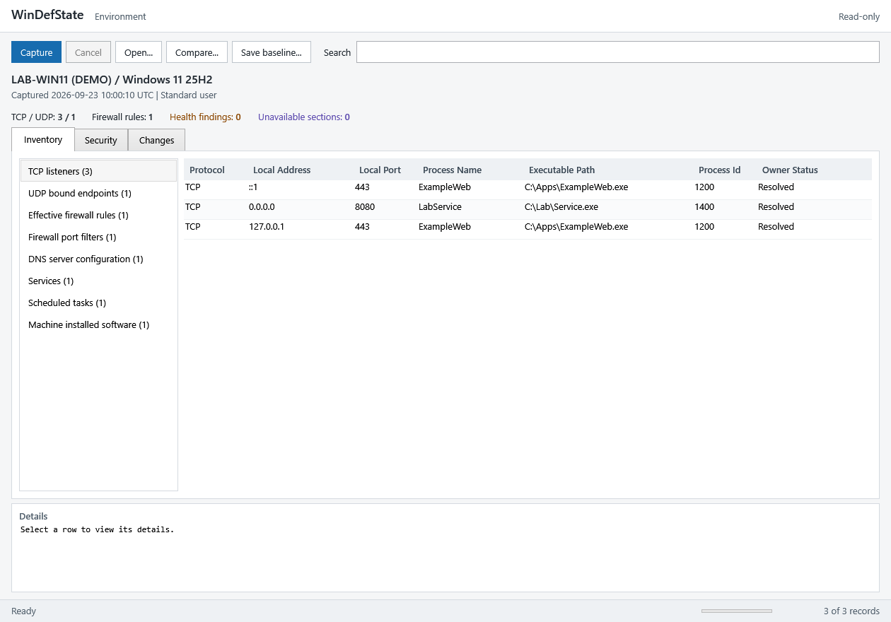

# WinDefState

Capture a Windows environment before testing and compare it afterward.

- TCP listeners and UDP endpoints, with process ownership
- Firewall rules, network configuration, services, tasks, and installed software
- Windows security health and version support
- JSON baselines, before/after comparisons, and HTML reports



## Start

[Download the source ZIP](https://github.com/mikegropp/WinDefState/archive/refs/heads/main.zip),
extract it, and run this from the extracted folder:

```powershell
powershell.exe -NoProfile -Sta -File .\WinDefState.Inspect.Gui.ps1
```

Requires Windows 10 or 11 and 64-bit Windows PowerShell 5.1. Run as administrator
for complete firewall reads. Unavailable data is marked **Unknown**.

The inspection UI saves environment inventory to JSON without changing Windows
settings. These files support comparison only. Use a VM checkpoint or disk backup
to restore the whole machine.

## Coverage

### Environment inventory

| Area | Captured data |
| --- | --- |
| Local ports | IPv4/IPv6 TCP listeners and UDP bindings; owning PID, process name, and executable path |
| Firewall | Effective profiles and rules, policy source, direction/action, ports/protocols/ICMP, addresses, apps/packages, services, interfaces, authentication/encryption, and user/machine filters |
| Networking | Adapters and driver versions, IP addresses, DNS server order, routes, and connection profiles |
| Services | State, startup mode, service account, executable path, and delayed start |
| Scheduled tasks | State, principal, run level, and executable/COM actions; excludes arguments and triggers |
| OS version | Edition ID, display version, build number, and update build revision (UBR) from the local version registry key |
| Peripheral policy registry | Machine and capture-user removable-storage access policy keys, plus machine device-installation restrictions; preserves absent, empty, explicit disabled, and enabled registry values without asserting effective USB behavior |
| Software and updates | Machine-installed 32/64-bit software and reported Windows hotfixes; excludes per-user/Store apps |
| Security health | Windows version/support, Defender mode and protection status, signature age, Secure Boot, TPM readiness, running Credential Guard/VBS/HVCI, firewall profile state, and pending-restart markers |

Local bindings do not establish external reachability. Hotfix inventory is not a
complete patch assessment. See the [inspection guide](docs/INSPECTION.md) for limits.

### Protection-state engine

The separate `WinDefState.ps1` engine captures and restores supported protection
settings. Its permissive test mode weakens host security and is intended for
isolated, authorized testing. Environment baselines and engine restore snapshots
are different formats.

| Area | Covered settings and state |
| --- | --- |
| Microsoft Defender | Real-time and behavior monitoring, cloud protection (MAPS), sample submission, PUA, script/IOAV scanning, network inspection/protection, controlled folder access, exclusions and allow/protect lists, ASR rule IDs/actions, running mode, tamper status, local engine/scanning state, and signature ages/versions |
| Windows Firewall | Profile state, default actions, notifications, unicast response handling, and logging |
| PowerShell | Machine lockdown policy, script block logging, module logging, and transcription |
| Application control | AppLocker service and effective policy with collection enforcement; WDAC/App Control active policies and files; Windows Script Host, Windows shell SmartScreen machine policy, and Microsoft Edge mandatory machine SmartScreen policy |
| Exploit protection | System/application mitigation policies and SEHOP |
| Accounts and UAC | Built-in Administrator state, UAC settings, and remote local-account token filtering |
| RDP | Connections, NLA, security layer, encryption level, listener state, clipboard/drive redirection, firewall rule group, and Restricted Admin |
| Credential protection | LSA, Credential Guard, VBS, HVCI, and WDigest registry controls; current-boot LSA protected-process evidence; Windows LAPS policy and event metadata |
| Authentication | LAN Manager/NTLM compatibility and client/server session security, LDAP signing, anonymous SAM/share enumeration, Everyone-token membership, blank-password remote use, and cached domain logons |
| Network policies | NetBIOS over TCP/IP, WPAD WinHTTP and per-user auto-detect, LLMNR, and mDNS |
| Time synchronization | Windows Time service, live sync status/source, and configured NTP peers |
| Auditing and telemetry | Process creation and Filtering Platform Connection audit subcategories, plus telemetry registry controls |
| Print Spooler | Service state and remote client connection policy |
| WinRM | Service startup, listeners, client/service authentication, TrustedHosts, and IPv4/IPv6 filters |
| SMB | Client/server signing, insecure guest authentication, and client encryption requirement |
| BitLocker | Mounted-volume protection state, protector inventory, and auto-unlock |
| Office | Internet macro-blocking policy across user profiles |

The Controlled Folder Access folder and app lists show additional protected
folders and explicit app allowances. They do not enumerate built-in protected
folders or apps Defender automatically trusts. Interpret them with the CFA mode;
empty lists alone do not establish effective folder or app behavior.

Restoration depends on a complete baseline and provider support. Defender mode,
current-boot LSA evidence, LAPS policy, Windows Time status, and Edge machine
SmartScreen policy are inventory only. A missing SmartScreen machine policy is
unconfigured, not proof that the feature is off. The Edge registry value does
not establish whether Edge applied the policy or what a user sees; inspect
`edge://policy` in the intended interactive session. A missing per-user
WinINet `AutoDetect` DWORD does not prove effective auto-detection is off.
Defender's local state does not establish cloud connectivity or a behavioral
block verdict. Network inspection is separate
from Network Protection. See the [state reference](docs/STATE.md) for restore
limits and [Microsoft's Edge policy reference](https://learn.microsoft.com/en-us/deployedge/microsoft-edge-policies/smartscreenenabled).

## Command line

Run the captures before and after testing, respectively:

```powershell
.\WinDefState.Environment.ps1 -OutputPath .\before.json
.\WinDefState.Environment.ps1 -OutputPath .\after.json
```

Compare the saved files:

```powershell
.\WinDefState.Environment.ps1 -BaselinePath .\before.json -CurrentPath .\after.json -OutputPath .\changes.html -Format Html
```

## Documentation

- [Inspection guide](docs/INSPECTION.md) — coverage, comparisons, and limitations
- [State reference](docs/STATE.md) — saved files, recovery, and provider caveats
- [Development](docs/DEVELOPMENT.md) — tests and release builds
- [Architecture](docs/ARCHITECTURE.md) — implementation and compatibility contracts
- [LAPS inventory](docs/LAPS-INVENTORY.md) — policy precedence and password-free event metadata
- [Time inventory](docs/TIME-SYNC-INVENTORY.md) — sync status and independent clock comparison
